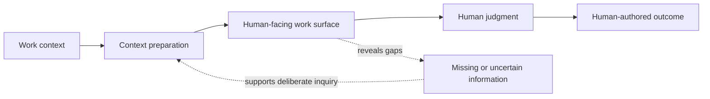

[English](ARCHITECTURE_OVERVIEW.md) | [日本語](ARCHITECTURE_OVERVIEW.ja.md)

# Conceptual architecture overview

This diagram describes a research concept only. It does not disclose or claim a deployed architecture.

Conceptually, the system would prepare relevant context, present it for inspection, surface uncertainty or gaps, and support a person in creating an outcome. The person remains responsible for consequential judgment and authorship.

This model omits implementation choices, data flows, infrastructure, security controls, and internal algorithms. It should not be taken to mean any component exists today.
